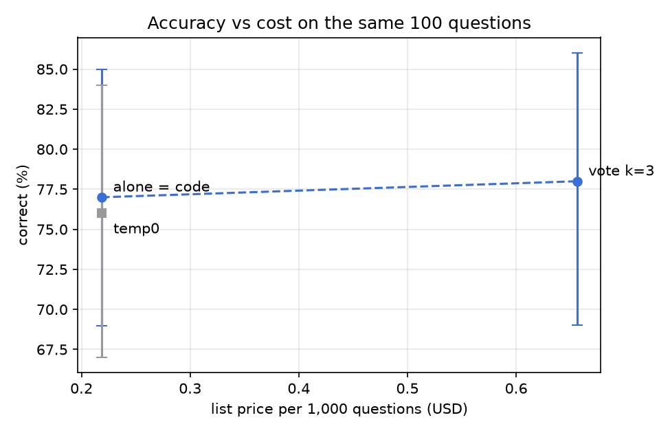

# finqa-trust

[](https://github.com/negmohtaram/finqa-trust/actions/workflows/ci.yml)

Which steps of financial question answering can a language model be trusted with: finding the right numbers in a report, calculating with them, or neither? And what does each common fix (temperature 0, majority voting, letting the model write code) buy in accuracy and cost?

## Data
Two public benchmarks built from real company reports, both with checkable answers:
- [FinQA](https://github.com/czyssrs/FinQA) (Chen et al., 2021): questions over earnings reports, each with the gold calculation program.
- [TAT-QA](https://github.com/NExTplusplus/TAT-QA) (Zhu et al., 2021): questions over tables and text from annual reports.

Only the dev and test splits are used. Test results are reported once, at the end.

## Setup
```bash
python3 -m venv .venv && source .venv/bin/activate
pip install -e ".[dev]"
python scripts/download_data.py
pytest -q
```

## Baseline: where the model fails
Model: `openai/gpt-oss-120b` (reasoning effort low, temperature 1.0), asked for the numbers it used, its formula and its answer as JSON. 100 arithmetic questions (55 FinQA, 45 TAT-QA) from a fixed stratified dev sample, each asked twice. Every wrong answer is labelled by the first step that broke, checked against the gold calculation:

| Label | Meaning | Share (mean of 2 runs) | Run spread | 95% CI (run 0, bootstrap) |
|---|---|---|---|---|
| correct | matches gold at 0.5% | **77.5%** | 77–78% | 69–85% |
| extraction | a number the gold calculation needs is missing | 9.0% | 8–10% | 4–16% |
| formula | right numbers, logic not equivalent to gold | 10.0% | 10–10% | 4–16% |
| sign | right magnitude, opposite sign | 3.0% | 3–3% | 0–6% |
| arithmetic | right formula, answer is not what it computes to | 0.5% | 0–1% | |
| unreadable / format / unchecked | | 0% | | |

What this says:
- **The model reads and reasons badly far more often than it calculates badly.** Extraction and formula errors are about 19% of answers; arithmetic slips are 0.5%.
- **Repeating a run shows little model randomness:** 95 of 100 questions got the same verdict both times. The much larger uncertainty is which questions were sampled: on 100 questions one accuracy is about ±8 points.
- **FinQA is much harder than TAT-QA here:** 64% vs 94% correct. Typical FinQA failures are choosing the wrong total, ignoring a "minus 100" in cumulative return questions, adding items the question did not ask for, and stopping before the final division.
- **Sign is a convention problem, not a reasoning one.** For questions about a decline the model often gives the positive size. These are scored as wrong and counted separately.

How formulas are compared: a formula that matches the gold number once could be a coincidence, so both formulas are recomputed with every gold number swapped for random values, five times. They count as equivalent only if they agree every time. Gold calculations are used only when they reproduce the gold answer; a few do not (for example a TAT-QA derivation of -114 - (71) with a gold answer of -43), and those items are reported as unchecked. A few golds are simply wrong (an equity share given as 1 - 45.6), so no system reaches 100%.

Reproduce:
```bash
python scripts/make_samples.py
python scripts/run_baseline.py --runs 2
```
The model calls behind these numbers are stored in `results/recordings/`, so this replays them with no API key and no network. Questions without a recording are sent to Groq, which needs `GROQ_API_KEY`.

## Four approaches: what fails and what it costs

The same 100 questions were answered four ways: the model alone, the model's formula run as code, temperature 0, and a majority vote over three samples. Prices are Groq's list price for the same tokens (the runs used the free tier). The full table is in `results/comparison.md`.

| approach | correct (95% CI) | list price per 1,000 correct |
|---|---|---|
| alone | 77% (69 to 85) | $0.28 ($0.26 to $0.32) |
| code | 77% (69 to 85) | $0.28 ($0.26 to $0.32) |
| temperature 0 | 76% (67 to 84) | $0.29 |
| vote, 3 samples | 78% (69 to 86) | $0.84 ($0.76 to $0.95) |



I read all 25 questions that any approach got wrong and grouped them by cause.

| cause | wrong answers (alone) |
|---|---|
| Gold answer is wrong; the model's answer is right or the gold cannot be trusted | 5 |
| Question is ambiguous (sign, amount or percent, which base) and the model's reading is fair | 7 |
| Right kind of number from the wrong row, segment or period | 4 |
| Returned an input value or refused instead of computing the ratio | 4 |
| Finance convention missed (cumulative return measured from a base of 100) | 2 |
| Random slip seen in one sample only | 1 |

Only one failure in 25 was a misread number. The automatic "extraction" label was too broad here. Most of those cases were the wrong row, a missing calculation or a broken gold answer. On the 95 questions with a trustworthy gold answer the model alone scores 81%. Most errors repeat in every approach, temperature 0 and voting included, so they are systematic and more samples do not remove them.

**What I would ship.** The model alone, with its formula run as code. At list price it costs $0.28 per 1,000 correct answers, and the accuracy interval puts that between $0.26 and $0.32. Running the formula adds nothing to the price and protects against arithmetic slips. Voting triples the cost for one extra correct answer, which is within noise. Temperature 0 changed one answer net. The next step is a better input and a check, not more samples. When the formula is empty or the answer is not the ratio the question asks for, the model gets one retry with the reason. Each value will also name the row and column it came from, so code can verify it.

## How many questions are enough?
On one fixed sample, two approaches can be compared question by question. Only the questions where they disagree carry information, which makes paired comparisons much cheaper than comparing two separate test sets:

| Goal (accuracy about 60%, 95% confidence, 80% power) | Questions needed |
|---|---|
| One accuracy within ±3 points | about 1,025 |
| A 3-point difference, two separate question sets | about 4,186 each |
| A 3-point difference, same questions, 15% disagreement | about 1,308 |
| Smallest difference 400 shared questions can detect (15% disagreement) | about 5.4 points |


Code: `src/finqa_trust/stats.py`.
